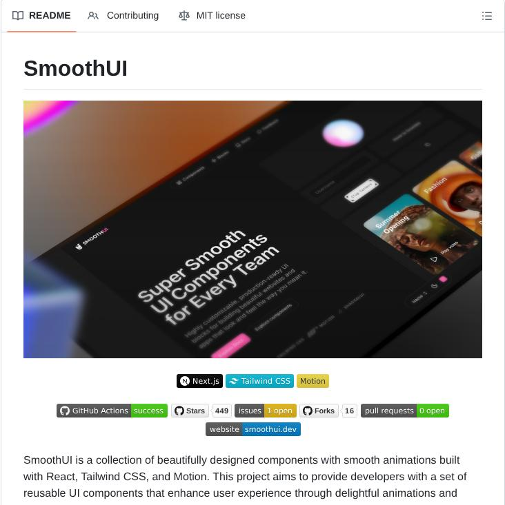
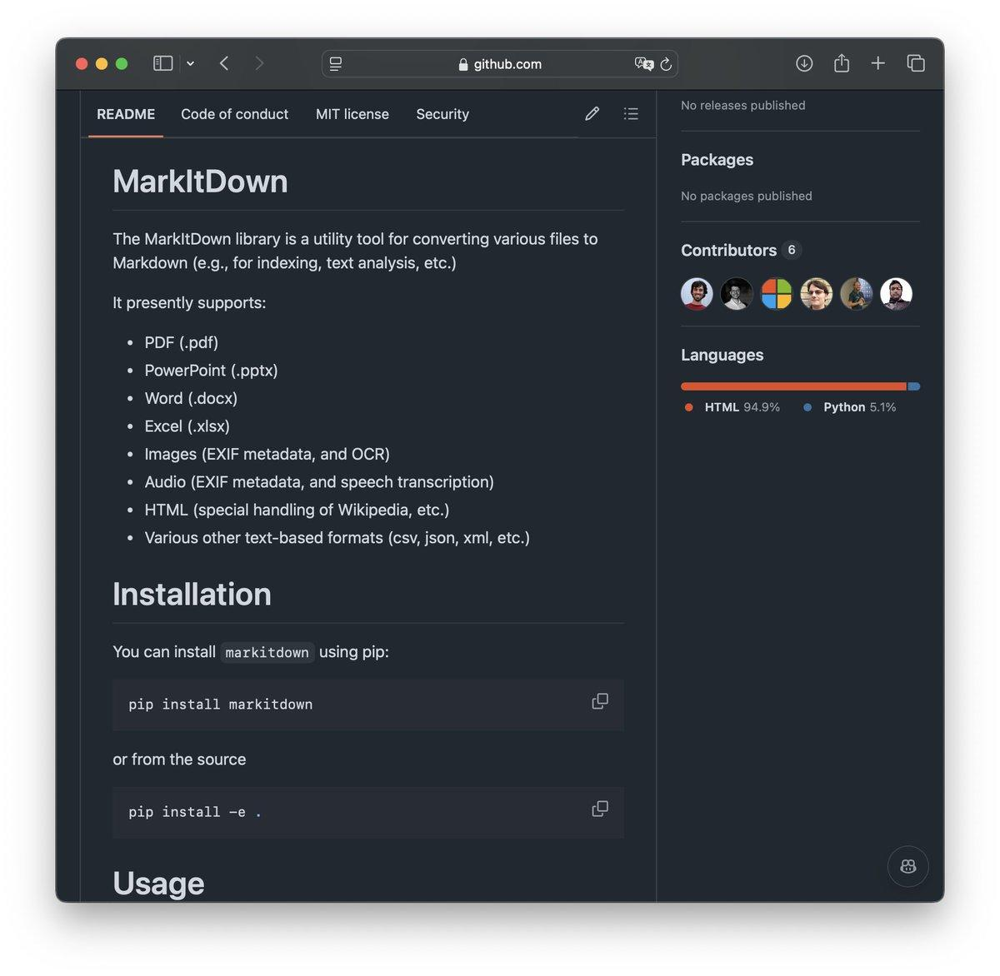
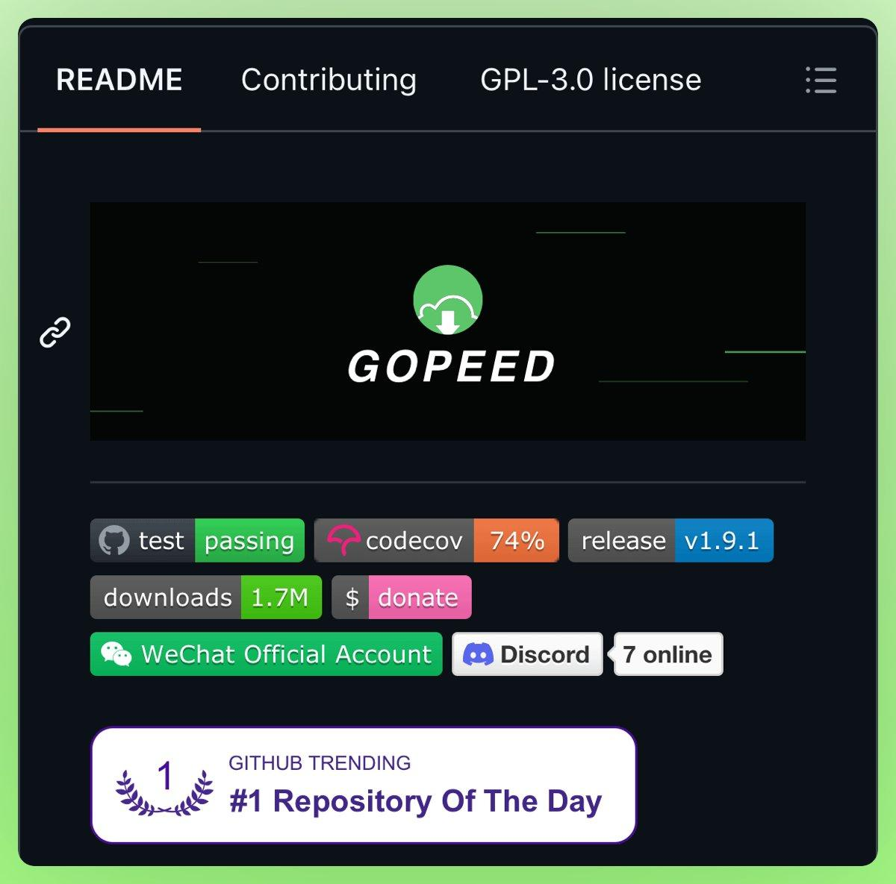

<div align="center">


# SKY LAND

### Central de controle para executores e ferramentas Roblox

Baixe executores, instale dependências e gerencie suas ferramentas em um só lugar — com interface moderna, temas personalizados e atualização automática.

[](https://github.com/Joaovictor18383/Sky-land-/releases)
[](https://dotnet.microsoft.com/download)
[](SkyLand.csproj)
[](https://github.com/Joaovictor18383/Sky-land-/releases)

</div>

---

## Sobre o projeto

O **SKY LAND** é um aplicativo desktop para Windows que centraliza o download e a manutenção das principais ferramentas do ecossistema Roblox. Ele verifica dependências do sistema, baixa os arquivos oficiais das fontes corretas e oferece reparo e gerenciamento sem exigir conhecimento técnico.

Cada operação passa por confirmação explícita na tela, os downloads são validados por tamanho e hash quando disponível, e nenhum executável é executado sem o seu consentimento.

## Capturas de tela

<div align="center">

| | | |
|:---:|:---:|:---:|
|  |  |  |

</div>

## Funcionalidades

### Executores

| Executor | O que o app faz |
|---|---|
| **Potassium** | Download do pacote oficial + verificação de dependências |
| **Madium** | Download do instalador, atualização e **reparo completo** de instalações problemáticas |
| **Real** | Download do RealSetup com instalação automática de pré-requisitos |

### Ferramentas e utilidades

- **Status dos executores (WEAO)** — consulta em tempo real a disponibilidade de Potassium, Madium e Real
- **AnyDesk** — download direto para acesso remoto
- **Fishstrap** — sempre a versão mais recente via GitHub API
- **Roblox Account Manager** — download do gerenciador de contas
- **MultiBloxy** — download direto da release oficial

### Sistema

- **Instalação automática de dependências** — .NET 6/8 Desktop Runtime, WebView2 e Visual C++ x64/x86, tudo com confirmação prévia
- **Pasta de downloads personalizada**
- **Verificação de atualizações** com histórico de releases do repositório
- **4 temas de cores** — Preto, Azul, Verde e Vermelho
- **Registro de atividades** e limpeza de arquivos temporários
- **Notificações visuais** de progresso, sucesso e erro em cada operação

## Requisitos

- Windows 10/11 **x64**
- Conexão com a internet
- As dependências (.NET, WebView2, VC++) são **oferecidas e instaladas pelo próprio app** na primeira utilização

## Instalação

1. Baixe o `SKY.LAND.exe` (ou `SKY.LAND.Setup.exe`) em [**Releases**](https://github.com/Joaovictor18383/Sky-land-/releases)
2. Execute o arquivo — não é necessário instalar nada antes
3. Na primeira operação que exigir dependências, o app oferece baixá-las e instalá-las automaticamente

## Como usar

1. Abra o **SKY LAND**
2. Escolha uma ferramenta no menu lateral ou nos atalhos da tela inicial
3. Clique na ação desejada (baixar, verificar status, reparar)
4. Acompanhe o progresso na barra do próprio card
5. Quando terminar, use **"Abrir pasta"** para localizar o arquivo baixado

> **Segurança:** nenhuma operação de download ou instalação acontece sem a sua confirmação. O app nunca solicita senhas, cookies ou tokens de contas.

## Temas

Quatro temas disponíveis em **Configurações → Tema do aplicativo**:

- ⬛ **Preto** — grafite neutro
- 🔵 **Azul** — azul marinho
- 🟢 **Verde** — verde floresta
- 🔴 **Vermelho** — vinho moderno

## Compilando do código-fonte

Pré-requisito: [.NET 8 SDK](https://dotnet.microsoft.com/download)

```bash
git clone https://github.com/Joaovictor18383/Sky-land-.git
cd Sky-land-
dotnet publish SkyLand.csproj -c Release -r win-x64
```

O executável sai em `bin\Release\win-x64\publish\SKY LAND.exe`.

## Perguntas frequentes

**O app é seguro?**
Sim. Ele não pede credenciais, não executa nada sem confirmação e valida os arquivos baixados. Veja a seção [Segurança](SECURITY.md).

**Preciso instalar o .NET antes?**
Não. Se faltar, o app detecta e oferece a instalação automática durante o uso.

**O download do Madium não funciona mais — e agora?**
O Madium mudou de distribuição. O app resolve o link atual do MediaFire na hora do download e oferece também o modo de reparo completo.

**Como reportar um problema?**
Abra uma [issue](https://github.com/Joaovictor18383/Sky-land-/issues) descrevendo o que aconteceu, ou verifique o `skyland.log` em `%APPDATA%\SKY LAND\`.

## Contribuindo

Contribuições são bem-vindas. Leia o [CONTRIBUTING.md](CONTRIBUTING.md) para saber como compilar e propor melhorias.

## Créditos

- **Desenvolvido por:** Joaovictor36484
- **Repositório:** [Joaovictor18383/Sky-land-](https://github.com/Joaovictor18383/Sky-land-)

---

<div align="center">

**SKY LAND** — controle total das suas ferramentas Roblox

</div>
